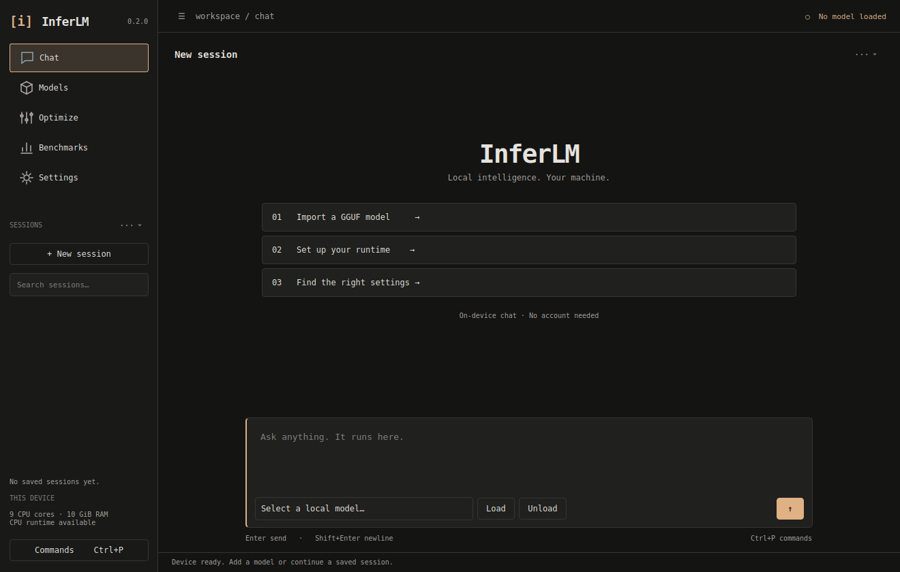
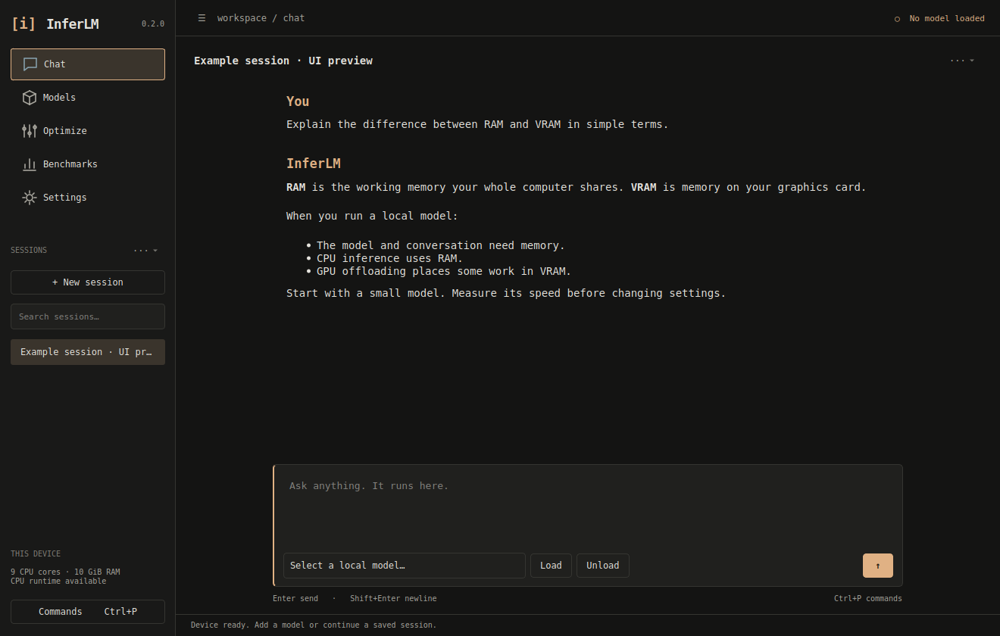
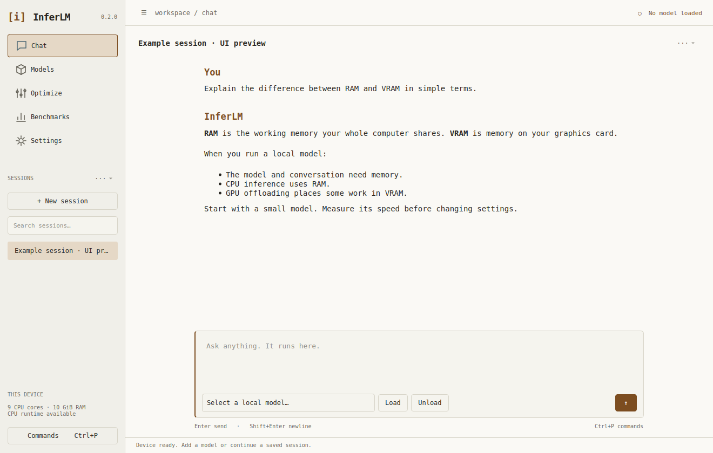

# InferLM
**Local AI chat and measured settings for your laptop.**

Development release **0.2.0**. Import a local GGUF, chat through llama.cpp,
benchmark the configuration, and save a tuning profile backed by measurements.



The 0.2 desktop uses a terminal-inspired workspace: one sidebar, searchable
sessions, monospaced text, warm neutral themes, and a centered conversation.
Press **Ctrl+P** for commands, **Ctrl+B** to toggle the sidebar, and **Ctrl+N**
for a new session. Chat/session menus keep secondary actions close at hand.

[Design and shortcuts](docs/DESIGN.md) · [Release notes](docs/RELEASE_NOTES.md)

## What works
- Native Qt desktop: Chat, Models, Optimize, Benchmarks, Settings.
- Independent dark/light themes, searchable commands/sessions, keyboard controls and background jobs.
- Supported GGUF import/relinking and conservative separate RAM/VRAM planning.
- Pinned CPU runtime download from Settings.
- Streaming, stop/retry/edit, saved chats and Markdown/JSON exports.
- Token-aware shorter branches that preserve the original conversation.
- Repeated native/server benchmarks and bounded tuning with a baseline recheck.
- Hardware/model/runtime-bound profiles and a shared optional CLI.

## Native packages
The current 0.2 release is source-only. To build a Windows/Linux package on
GitHub, open **Actions → Native unsigned packages → Run workflow** and download
the matching artifact after it succeeds. Native 0.2 binaries are not yet verified.

The earlier 0.1 Linux package was verified as described below.
Unzip the full package and run `./InferLM`. Keep `_internal` and `runtime`
alongside it. The CPU runtime is bundled. No Python installation is required.
If permissions were lost: `chmod +x InferLM`.

This build requires Linux x86-64 and glibc 2.39+. On X11 install
`libxcb-cursor0` if the Qt platform plugin reports it missing.
Physical Ubuntu/Mint desktop verification remains pending.
No model weights are bundled.

## Source installation
Python 3.12; initial dependency installation needs internet.

Windows PowerShell (open the terminal in the repository folder):
```powershell
py -3.12 -m venv .venv
.venv\Scripts\python.exe -m pip install -r requirements-lock.txt
.venv\Scripts\python.exe -m pip install --no-deps -e .
.venv\Scripts\python.exe -m inferlm
```

Linux:
```bash
python3.12 -m venv .venv
.venv/bin/python -m pip install -r requirements-lock.txt
.venv/bin/python -m pip install --no-deps -e .
.venv/bin/python -m inferlm
```

For a smaller non-development install, use `python -m pip install ".[gui,cli]"`.
The lockfile records tested versions with Windows-specific dependency markers.
PySide6-Essentials supplies Widgets/SVG; WebEngine is unnecessary.

## First launch
1. Settings: use bundled runtime, or Download pinned CPU runtime; Validate & save.
2. Models: add an existing single-file GGUF.
3. Chat: choose model, Load model, and send a message.
4. Benchmark before Quick Tune. Apply a measured profile, then reload.

After dependencies/runtime/model are installed, chat and tuning work offline.
Models have their own licenses. Start with a small instruct model.

## CLI
```text
inferlm doctor --json
inferlm configure ./llama-runtime-b11564
inferlm models add /path/to/model.gguf
inferlm models list
inferlm chat --model MODEL_ID
inferlm benchmark --model MODEL_ID
inferlm optimize --model MODEL_ID --mode quick --budget 900
inferlm profiles list
inferlm profiles apply PROFILE_ID
```
The optional CLI uses the Python/source installation. It shares services,
storage and an inference lease with the GUI.

## Verification and limits
For 0.2: **57 tests passed, 3 real-runtime tests skipped**. Ruff and mypy passed.
Actual Qt screens were inspected at 1320×840, 960×620, and 2× scale.

Earlier 0.1 validation included 53 tests with real CPU fixtures, Qwen chat in the
standalone Linux executable, benchmarks, and a tuning/profile workflow.
Those historical reports remain under docs/validation. They were not rerun as
0.2 native-package verification.

Windows native execution, actual NVIDIA/Vulkan acceleration, physical target
laptops, 200% scaling and real Ubuntu/Mint desktop verification remain pending.
Split/IQ models are deferred. NVIDIA telemetry is implemented; other providers
are unavailable. Memory estimates are conservative and may reject practical
offloaded configurations. Tuning evaluates speed/stability, not answer quality.

See [Getting started](docs/GETTING_STARTED.md), [Testing](TESTING.md),
[Architecture](ARCHITECTURE.md), [Troubleshooting](docs/TROUBLESHOOTING.md),
[Status](PROJECT_STATUS.md) and [Release instructions](docs/RELEASE.md).

Original code is MIT. Dependencies and models retain their own licenses.

## Chat preview

The example conversation is a UI preview, not a recorded inference result.


